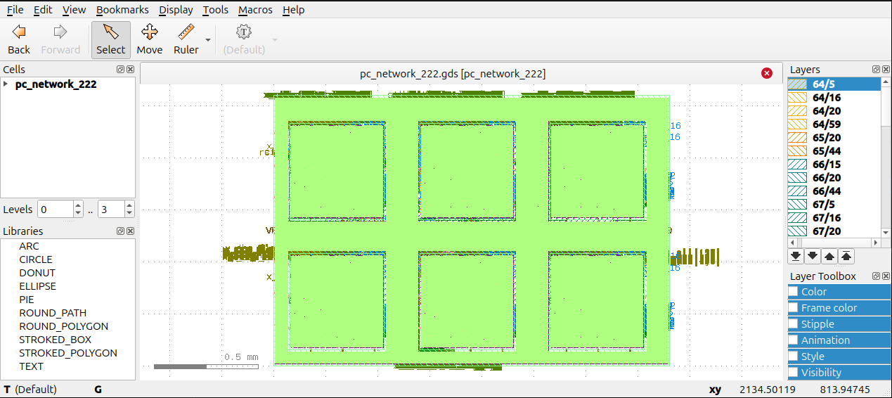

# Digital Predictive Coding Hardware

As of November 2026, there is debate on whether predictive coding has computational advantages over backpropagation. The reality is that backpropagation has been extensively optimized on the CPU-GPU stack, and predictive coding requires simulating the inference phase which will always be less computationally efficient than backpropagation. It might be possible though, that the locality of predictive coding as well as other biologically plausible features could be exploited to produce computational advantages on neuromorphic hardware. Do such advantages exist?

The answer is YES. Predictive coding can be made in a way to compute gradients with much lower latency than backpropagation on traditional hardware that would scale indefinitely to larger neural networks. This efficiency can be realized by making a few design choices, some of which differ from conventional hardware in many ways:

- Online learning. This implementation uses the incremental predictive coding by Salvatori et al.: https://arxiv.org/pdf/2212.00720 which differs from the canonical implementation of predictive coding by merging the inference and the learning phase such that both can be executed in a loop, removing the need for a central controller that explicitly switches the network between inference and learning phases.

- Every core owns its own finite state machine. The completion of a single cycle of all the FSM stages refers to a tick. A tick involves computing the delta x and delta theta for that neuron, which involves the inference and learning phases of predictive coding

- Every neuron owns it's own MAC unit. The efficiencies come from the layout of the neural network. Since the cycles a neuron would have to process per tick is a linear function of the numbers of neurons it is connected to, asymptotically the convergence rate for larger networks becomes much smaller. If the number of connections for a single neuron (referred to in the paper as fan-in for the connections to the layer below, and fan-out for the connections to the layer above) is held constant, then the time to convergence does not change with network size. It is an interesting question whether the brain implements something similar.

- A neuron in the predictive coding algorithm represents a physical core. Every core connects locally to it's neighboring cores. This architecture utilizes the locality of predictive coding. Assume for the sake of argument that neuron $i$ in layer $l$ is connected to $J$ neurons in the layer above and $K$ neurons in the layer below. The core utilizes $2J$ connections, for receiving the activities $x_{j}$ from the layer above and sending signals back, as well as sending activities to the K neurons in the layer below and receiving them. In total, there are at least $2J + 2K$ pins that enter each neuron core, plus additional ones for clock, reset pin, etc. The specific architecture details are prone to change, as I (and hopefully future collaborators) make adjustments to optimize the design further.

- All cores operate in parallel. If a tick means that all the stages of the FSM complete in X cycles, then for every X cycles, all the neuron cores are updated with a step in the delta x and delta theta gradient direction. Because memory and compute are co-located, there is no memory movement like in von Neumann architectures. This is where the efficiency comes from.

- Mortality. A key feature of von Neumann machines are that hardware and software are separate, which allows instructions that are specified on one machine to be replicated on another machine. The software is separate from the hardware. This is a crucial property that makes modern digital machines different from the human brain. Mortality is realized in this system by first restricting the functionality to only implement the predictive coding update equations. In contrast to CPUs and GPUs, a core in this hardware only does one thing. While this might seem like it'd render the hardware useless due to its lack of programmability, it should be emphasized that the efficiencies of this hardware comes about by making this tradeoff. The fact that the functionality is restricted to the predictive coding updates allows a core to be much more compact in its machinery. This provides also a concrete advantage over immortal systems: the activities and weights of a neuron core (except at the boundaries of a predictive coding network) do not have to be read out in order for the system to work. This allows a single PC neuron to be miniaturized further by reducing pin congestion and would allow them to be scaled further by saving area on silicon.

# Quick Start

The repository gives two functionalities. Run the testbench to ensure the RTL converges to some sensible local minimum, and take larger networks from RTL to GDS. Nix is used to provide a project's development tools. First install Nix

```bash
nix develop path:.
./scripts/run_test.sh env
```

This opens the shell using the project's Nix configuration, and checks that the tools are available

## RTL testing

```bash
mkdir -p runs

./scripts/run_test.sh rtl tb/tb_scale_function.sv tb_scale_function \
  -- \
  +N_SAMPLES=8 +EPOCHS=20 +SEED=0 \
  +SETTLE_TICKS=20 +TRAIN_TICKS=20 +EVAL_TICKS=50 \
  +CSV=runs/rtl_smoke.csv
```

This creates a run directory and runs a three layered PC network with 2->4->3. It learns a fixed function

$$
y=A\, \mathrm{ReLU}(Bx), 
\qquad
x = \begin{bmatrix} x_1 \\ x_2 \end{bmatrix}.
$$

## RTL to GDS

A PC neuron is represented by `neuron_core` RTL module in `nc_neuralcomputer.sv`. This is first hardened as a neuron macro, then used to create the full predictive coding network GDS files.

```bash
librelane --design-dir . --run-tag neuron_serial \
  configs/neuron_2_3.json
```

This hardens a neuron macro. We can build a 2->2->2 network:

```bash
librelane --design-dir . --run-tag network_serial \
  configs/network_2_2_2.json
```

The results are stored in `runs/`. We can view the result with klayout

```bash
klayout runs/network_serial/final/gds/pc_network_222.gds
```



# Repository Layout

```text
neuralcomputer/
├── README.md       # Project overview and quick start
├── flake.nix       # Development environment
├── rtl/            # Hardware modules
├── tb/             # RTL testbenches and teacher definitions
├── scripts/        # Commands and Python experiments
├── configs/        # LibreLane configurations
├── figures/        # Images referenced by the README or paper
├── HardFloat/      # Floating-point library
├── runs/           # Local LibreLane results and required macros (ignored)
└── tmp/            # Local LaTeX builds and experimental output (ignored)
```

# Architecture

The network is built form three main modules in `rtl/nc_neuralcomputer.sv`:

- **`neuron_core`** implements one predictive-coding neuron. It stores its activity, incoming weights, and bias, and computes local prediction errors and updates.
- **`pc_layer`** connects neuron cores into a layer.
- **`pc_network_nlayer`** connects layers into a network.

Every neuron receives activities from the layer above and contributions from the layer below. It sends its own activity downward and contributions upward. Connections are bit-serial, meaning that every connection carries one bit per clock cycle.

Every core has an FSM and a single FMA. One complete pass through the FSM stages is called a **tick**. During a tick, the core:

1. Receives neighboring activities and calculates its prediction \mu
2. Calculates error \epsilon
3. Exchanges weighted error contributions with neighboring cores.
4. Updates activity
5. Updates weights

All cores execute their updates concurrently. A core processes its connections over multiple clock cycles, reusing its FMA.

External observations can be clamped to selected neurons. In the supervised testbench, inputs and targets are clamped during training. During evaluation, inputs are clamped and output activities are free to evolve.

# Understanding neuron_core

`neuron_core` is the main module to understand in the repository. `pc_layer` and `pc_network_nlayer` compose `neuron_core` modules into layers and networks, respectively. `neuron_core` includes the FSM stages, which executes the $\mu$ and error updates, as well as the state and weight updates. A full cycle through the FSM is a tick. In `neuron_core` are the signals and declarations, followed by the combinational circuitry and the sequential circuitry.

## Signals and Declarations

| Section | What belongs there |
| --- | --- |
| Widths and constants | `RECW`, `J_EFF`, `RM_RNE`, `rec_zero`, `rec_one`, `rec_bias_lr`, `alpha`, `gamma`, `x_obs`, and their converters |
| Stored activity and weights | `theta`, its presets and bias initialization; `x_i`, `x_i_eff`, its reset value, and `ACT_LOCAL_FEAT` for `phi_prime_xi` |
| Communication | `x_col`, `back_tx`, `back_rx`, `rx_bit`, `back_bit`, `tick_cycle`, `BACK_START_CYCLE`, and serial wiring |
| Prediction | Counter `j`, input/bias selection, `ACT_PRE`, `xj_act`, `mu_acc`, and `mu_c_in` |
| Error | `eps_i` |
| Feedback | Counter `r`, `back_acc`, `back_sum_c_in`, and `back_eff` |
| Activity update | `sub_back_minus_eps` |
| Weight update | `m_i`, `m_i_bias_scaled`, and `m_i_eff` |
| MAC signals and FMA | `mac_op`, `mac_a`, `mac_b`, `mac_c`, `mac_out`, `mac_exc`, and `FMA_SHARED` |
| FSM | `st_e` and `st` |
| Combinational | `always_comb` block |
| Sequential | `always_ff` block |

## How each one works

<u>widths and constants</u>

Initializes constants, and converts some values like $0$, $1$, $\alpha$, $\gamma$ and converts them from the IEEE representation to HardFloat’s internal representation recFN

<u>stored activity and weights</u>

Initializes $θ$, which has $J+1$ elements because of the $J$ weights connecting to the $J$ neurons in the layer above and the bias. Initializes converters from the initial $θ$’s IEEE to recFN, as well as the bias. When the reset is asserted, the clocked FSM copies the presets into `theta`:

```systemverilog
for (int k=0; k<J; k++)
	theta[k] <= theta_preset_rec[k];

...

theta[J] <= theta_bias_init;
```

Subsequently, `x_i`, the core’s activity, is initialized. Similarly to the $\theta$ case, the converter from initial `x_i`’s IEEE to recFN is initialized and stored as `x_i_init_rec`, and `x_i_eff` overrides `x_i` with `x_obs` if the clamp `x_set_en` is enabled. Subsequently, `x_i_eff` is passed through the activation `ACT_LOCAL_FEAT` and stored in `phi_prime_xi`. Both `x_i_eff` and `phi_prime_xi` are used later.

<u>communication</u>

`x_col`, `back_tx`, and `back_rx` are arrays of registers. Each array element holds one complete RECW-bit value. During `S_RECEIVE_ACTIVITIES`, the assignment runs at each clock edge

```systemverilog
x_col[k][rx_bit] <= x_vec[k];
```

which stores the bit currently arriving on `x_vec[k]` into position `rx_bit` of `x_col[k]`. `rx_bit` advances from 0 through `RECW-1`. All $J$ lanes do this in parallel:

```text
clock 1: x_col[0][0] ← x_vec[0]	x_col[1][0] ← x_vec[1]
clock 2: x_col[0][1] ← x_vec[0]	x_col[1][1] ← x_vec[1]

...
```

`back_tx` receives a complete weighted-error value from the MAC during `S_PREPARE_FEEDBACK`. It is sent one bit at a time:

```systemverilog
assign back_vec[j] = back_tx[j][back_bit];
```

`back_rx[k]` is assembled one bit at a time during
`S_EXCHANGE_FEEDBACK`:

```systemverilog
back_rx[k][back_bit] <= back_in[k];
```

<u>prediction</u>

`j` is the counter that loops through the $J$ activities from the layer above. `xj_in_feat` selects the jth element from `x_col[j]` and that feature is passed through an activation to get `xj_act_raw`. `xj_act` uses `xj_act_raw` for an ordinary input and `1` for the bias lane.

`mu_acc` is the accumulator for $\mu$. `mu_c_in` selects 0 if `j` is 0. otherwise the `mu_c_in` selects `mu_acc`. The code always computes

`mac_out = theta[j] × xj_act + mu_c_in`

and the selector decides what `mu_c_in` carries:

```text
j=0: 
mu_c_in=0
mac_out = theta[0] × xj_act + mu_c_in
store result in mu_acc

j=1: 
mu_c_in=mu_acc
mac_out = theta[1] × xj_act + mu_c_in
store result in mu_acc

...

j=J:
mu_c_in=mu_acc
mac_out = theta[J] × 1 + mu_c_in
store final prediction in mu_acc
```

<u>error</u>

initializes register for the error. In the S_ERROR stage, the MAC calculates the difference. At the clock edge, the FSM stores it:

`eps_i <= mac_out;`

<u>feedback</u>

feedback stage is summed similarly to $\mu$ in the prediction stage. Each neuron below sends a weighted precision-error contribution

$$
\theta_{ki} \epsilon_k
$$

This core receives K such contributions in `back_rx[]` and adds them one at a time. `r` selects the contribution being added.

`back_acc` carries the running sum, `back_sum_c_in` carries the addend selected for the MAC. During `S_SUM_FEEDBACK`, the MAC computes:

`mac_out = back_rx[r] × 1 + back_sum_c_in`

At the clock edge, the FSM stores `mac_out` in `back_acc`. After all $K$ contributions,


$$
\text{back\_acc}=\sum_{k=0}^{K-1} \theta_{ki} \epsilon_k
$$

`back_eff` is storage for the gated feedback. During `S_GATE_FEEDBACK`, the MAC multiplies the completed sum by the local activation derivative

$$
\text{back\_eff}=f'(x_{i,eff})\text{back\_acc}
$$
<u>activity update</u>

`sub_back_minus_eps` stores the direction of the activity update:

$$
\text{sub\_back\_minus\_eps}=\text{back\_eff}-\epsilon_i
$$

In `S_ACTIVITY_DIRECTION`, the MAC calculates

`mac_out = back_eff × 1 - eps_i`

at the clock edge, 

```systemverilog
sub_back_minus_eps <= mac_out;
```

Then, in `S_UPDATE_ACTIVITY`, the MAC calculates:

`mac_out = gamma × sub_back_minus_eps + x_i`

and stores that result in the next clock edge. So the complete activity update is:

$$
x_i^{\mathrm{new}} = x_i + \gamma\left(\text{back\_eff}-\epsilon_i\right).
$$
<u>weight update</u>

Declares three signals `m_i`, `m_i_bias_scaled`, `m_i_eff`. `m_i` stores $\alpha\epsilon_i$, `m_i_bias_scaled` stores `m_i` multiplied by the bias learning-rate scale. `m_i_eff` is the selected increment for the current lane. The FSM carries out the calculation in three stages:

`S_SCALE_ERROR` uses the MAC to calculate and store
$$
m_i = \alpha\epsilon_i.
$$
`S_SCALE_BIAS_INCREMENT` calculates and stores
$ m_{i,\mathrm{bias}}=m_i\times\text{bias scale}$
`S_UPDATE_WEIGHTS` processes each weight, then the bias
$\theta[j]\leftarrow\theta[j]+m_{i,\mathrm{eff}}\times\text{xj\_act}$

FMA signals and FMA
declares the FMA signals and FMA. the FMA performs computation like

`mac_out = mac_a × mac_b + mac_c`

<u>combinational</u>

combinational circuitry

<u>sequential</u>

sequential circuitry

# Current Status and Future Directions

This predictive coding hardware is one step towards a program I call the inference engine. The idea is that von Neumann intermediary can be removed from the computational system, thereby achieving a computer that has is fully local, online, and parallel. The grander hypothesis is that achieving this would lead to a resolution of tasks considered difficult by Moravec's Paradox, which I have written about here: https://x.com/alskaf1293/status/2113007930845143244

I also strongly believe that this could be a step forward in a program that looks at alternative computing paradigms, including a reversion towards analog computing, active matter, or superconducting circuits. Analog circuits already seem much better suited for running predictive coding because PC is by nature a continuous time, energy-based dynamical system. I would not be surprised if a much more efficient way to run PC could be found on an analog circuit compared to digital CMOS. The problem is that the current computing ecosystem is built on digital CMOS, along with the software and EDA toolkits that currently exist. Analog can come in the future, but a first order proof of PC efficiencies would be much more feasible on digital hardware, hence this repository.

# Paper

This paper implements the result on arxiv: https://arxiv.org/pdf/2603.18066
At the present moment only smaller sizes have been tested for. Predictive coding and neuromorphic computing will eventually be the future of artificial intelligence, but it can only happen through persistent work of scaling hardware up.
