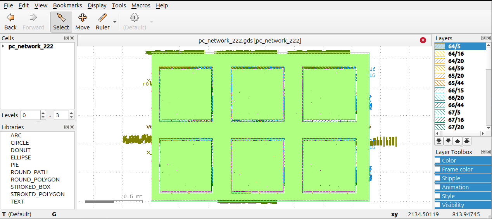

As of November 2026, there is debate on whether predictive coding has computational advantages over backpropagation. The reality is that backpropagation has been extensively optimized on the CPU-GPU stack, and predictive coding requires simulating the inference phase which will always be less computationally efficient than backpropagation. It might be possible though, that the locality of predictive coding as well as other biologically plausible features could be exploited to produce computational advantages on neuromorphic hardware. Do such advantages exist?

The answer is YES. Predictive coding can be made in a way to compute gradients with much lower latency than backpropagation on traditioanl hardware that would scale indefinitely to larger neural networks. This efficiency can be realized by making a few design choices, some of which differ from conventional hardware in many ways:

1. A neuron in the predictive coding algorithm represents a physical core. Every core connects locally to it's neighboring cores. This architecture utilizes the locality of predictive coding. Assume for the sake of argument that neuron i in layer l is connected to J neurons in the layer above and K neurons in the layer below. The core utilizes 2 J connections, for recieving the activities x_{j} from the layer above and sending signals back, as well as sending activities to the K neurons in the layer below and recieving them. In total, there are at least 2J + 2K pins that enter each neuron core, plus additional ones for clock, reset pin, etc. The specific architecture details are prone to change, as I (and hopefully future collaborators) make adjustments to optimize the design further.

2. Every core owns its own finite state machine. The completion of a single cycle of all the FSM stages refers to a tick. A tick involves computing the delta x and delta theta for that neuron, which involves the inference and learning phases of predictive coding

3. All cores operate in parallel. If a tick means that all the stages of the FSM complete in X cycles, then for every X cycles, all the neuron cores are updated with a step in the delta x and delta theta gradient direction. Because memory and compute are co-located, there is no memory movement like in von Neumann architectures. This is where the efficiency comes from.

4. Online learning. This implementation uses the incremental predictive coding by Salvatori et al.: https://arxiv.org/pdf/2212.00720 which differs from the canonical implementation of predictive coding by merging the inference and the learning phase such that both can be executed in a loop, removing the need for a central controller that explicitly switches the network between inference and learning phases.

5. Every neuron owns it's own MAC unit. The efficiencies come from the layout of the neural network. Since the cycles a neuron would have to process per tick is a linear function of the numbers of neurons it is connected to, asymptotically the convergence rate for larger networks becomes much smaller. If the number of connections for a single neuron (referred to in the paper as fan-in for the connections to the layer below, and fan-out for the connections to the layer above) is held constant, then the time to convergence does not change with network size. It is an interesting question whether the brain implements something similar.

# Future Directions

This predictive coding hardware is one step towards a program I call the inference engine. The idea is that von Neumann intermediary can be removed from the computational system, thereby achieving a computer that has is fully local, online, and parallel. The grander hypothesis is that achieving this would lead to a resolution of tasks considered difficult by Moravec's Paradox, which I have written about here: https://x.com/alskaf1293/status/2113007930845143244

I also strongly believe that this could be a step forward in a program that looks at alternative computing paradigms, including a reversion towards analog computing, active matter, or superconducting circuits. Analog circuits already seem much better suited for running predictive coding because PC is by nature a continuous time, energy-based dynamical system. I would not be surprised if a much more efficient way to run PC could be found on an analog circuit compared to digital CMOS. The problem is that the current computing ecosystem is built on digital CMOS, along with the software and EDA toolkits that currently exist. Analog can come in the future, but a first order proof of PC efficiencies would be much more feasible on digital hardware, hence this repository.

# Quick Start

The repository gives two functionalities. Run the testbench to ensure the RTL converges to some sensible local minimum, and take larger networks from RTL to GDS. Nix is used to provide a project's development tools

```bash
nix develop path:.
./scripts/run_test.sh env
```

This opens the shell using the project's Nix configuration, and checks that the tools are available

## RTL testing

```bash
mkdir -p runs

./scripts/run_test.sh rtl tb/tb_scale_function.sv tb_scale_function \
  -- \
  +N_SAMPLES=8 +EPOCHS=20 +SEED=0 \
  +SETTLE_TICKS=20 +TRAIN_TICKS=20 +EVAL_TICKS=50 \
  +CSV=runs/rtl_smoke.csv
```

This creates a run directory and runs a three layered PC network with 2->4->3. It learns a fixed function

$$
y=A\, \operatorname{ReLU}(Bx), 
\qquad
x = \begin{bmatrix} x_1 \\ x_2 \end{bmatrix}.
$$

## RTL to GDS

A PC neuron is represented by `neuron_core` RTL module in `nc_neuralcomputer.sv`. This is first hardened as a neuron macro, then used to create the full predictive coding network GDS files.

```bash
librelane --design-dir . --run-tag neuron_serial \
  configs/neuron_2_3.json
```

This hardens a neuron macro. We can build a 2->2->2 network:

```bash
librelane --design-dir . --run-tag network_serial \
  configs/network_2_2_2.json
```

The results are stored in `runs/`. We can view the result with klayout

```bash
klayout runs/network_serial/final/gds/pc_network_222.gds
```



# Notes and To Do

This paper implements the result on arxiv: https://arxiv.org/pdf/2603.18066
At the present moment only smaller sizes have been tested for. Predictive coding and neuromorphic computing will eventually be the future of artificial intelligence, but it can only happen through persistent work of scaling hardware up.